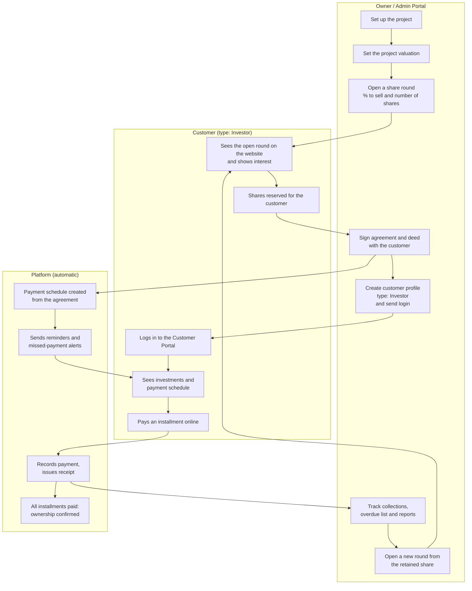
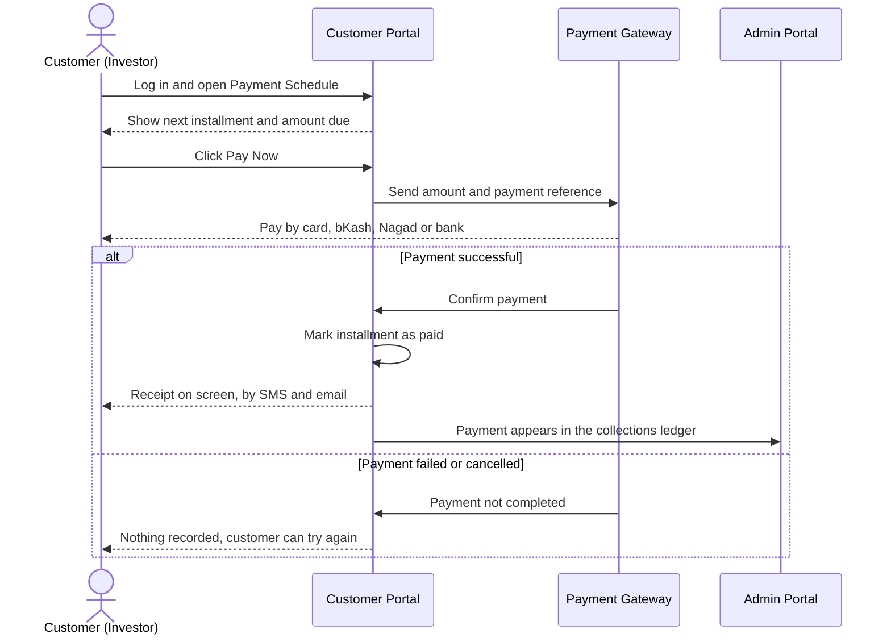
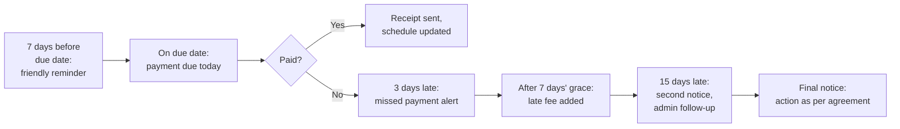
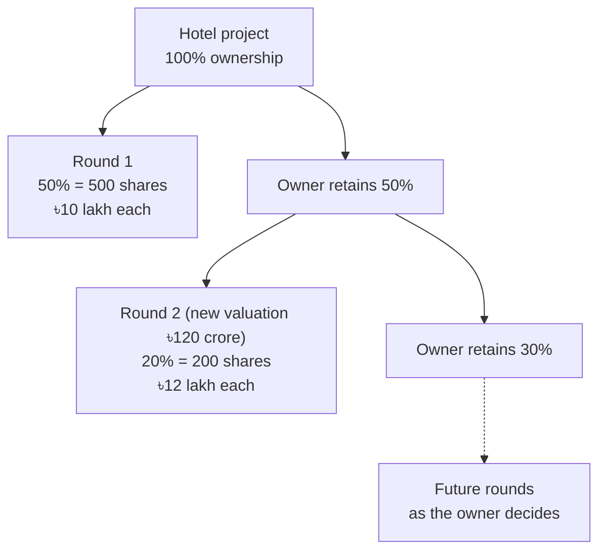
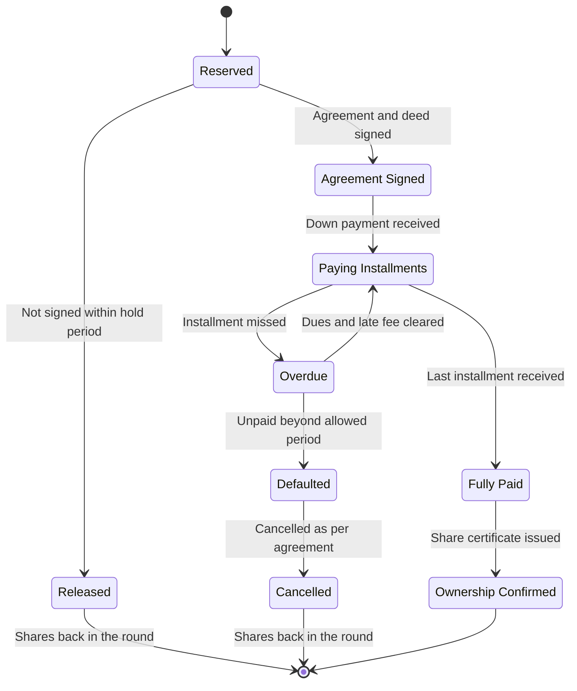

# Project Share Sale & Customer Portal

### Business Flow Proposal

| | |
|---|---|
| **Prepared for** | [Client name] |
| **Prepared by** | [Company name] |
| **Version** | 1.1 (draft for review) |
| **Date** | 31 October 2026 |
| **Purpose** | To describe how the platform will let the owner sell ownership shares of a project to many customers (type: Investor), manage agreements and installment payments, and give every customer a secure online portal. This document covers the business flow only; technical design follows after sign-off. |

---

## Contents

1. [Executive Summary](#1-executive-summary)
2. [Key Terms](#2-key-terms)
3. [The Big Picture](#3-the-big-picture)
4. [Step-by-Step Flow](#4-step-by-step-flow)
5. [Ownership Table Example](#5-ownership-table-example)
6. [Life of a Share Purchase](#6-life-of-a-share-purchase)
7. [Payment Calculation Example](#7-payment-calculation-example)
8. [Who Sees What](#8-who-sees-what)
9. [Decisions Required](#9-decisions-required)
10. [Delivery Roadmap](#10-delivery-roadmap)
11. [Security & Data Privacy](#11-security--data-privacy)
12. [Next Steps](#12-next-steps)

---

## 1. Executive Summary

The platform allows a project owner to raise funds by selling part of a project's ownership as
small, equal **shares** to many individual **customers**. Every share buyer is recorded as a
**Customer** with the customer type **Investor**.

- The owner values the project, decides **what percentage** to offer, and splits that percentage
  into a fixed **number of shares**. The price per share is calculated automatically.
- Each customer signs an agreement for the shares they buy. The agreement sets a **payment plan**
  (down payment plus monthly installments).
- The admin team creates the **customer profile** (type: Investor) and sends a login. The customer
  then uses the **Customer Portal** to see their investments, follow their payment schedule and
  **pay online**.
- Every payment is recorded and receipted. The system sends **reminders before due dates** and
  **alerts when a payment is missed**, so collections are tracked without manual follow-up.
- A customer can hold shares in **several projects** with one login.
- The owner can later open **new share rounds** from the part they kept, at the same or a new
  valuation.

**Value to the owner:** a clear record of who owns what, every taka due and received in one place,
fewer missed payments, and customers who can serve themselves online.

---

## 2. Key Terms

| Term | Meaning |
|---|---|
| **Project** | The property or business being shared, for example a 5-star hotel. |
| **Valuation** | The total value the owner places on the whole project (100%). |
| **Share** | One equal piece of ownership in a project. Each share carries a fixed percentage. |
| **Share Round** | One offering of shares: how many shares, at what price, open between which dates. A project can have several rounds over time. |
| **Customer** | A person or company registered on the platform. Every customer has a **customer type**. |
| **Customer type: Investor** | The customer type for anyone who buys project shares. In this document, "customer" always means a customer of type Investor. |
| **Agreement** | The signed contract (and deed, where required) between the owner and the customer. |
| **Payment Plan** | The schedule agreed in the agreement: down payment plus installments with due dates. |
| **Customer Portal** | The secure website area where customers log in to see their investments and pay. |
| **Admin Portal** | The owner's and staff's back office where everything is set up and tracked. |
| **Retained Share** | The part of the project the owner has not yet offered to customers. |

---

## 3. The Big Picture

---

## 4. Step-by-Step Flow

### Step 1 — Set up the project and its valuation

**Who:** Owner / admin

The admin records the project (name, location, type, photos, description) and sets its
**valuation** — the value of the whole project.

> **Example:** A 5-star hotel is valued at **৳100 crore**. This equals 100% ownership.

The valuation is kept with its date. If the project is revalued later, the new value is added as
a new entry, so the history is never lost.

---

### Step 2 — Open a share round

**Who:** Owner / admin

The owner decides:

1. **What percentage** of the project to offer in this round.
2. **How many shares** that percentage is split into.

The platform calculates the rest automatically.

> **Example:**
> - Offer **50%** of the hotel in Round 1.
> - Split it into **500 shares**.
> - Each share = 50% ÷ 500 = **0.1% ownership**.
> - Price per share = ৳100 crore × 0.1% = **৳10 lakh**.
> - Round 1 raises up to **৳50 crore** from as many as 500 customers.

Rules set for each round:

| Setting | Example |
|---|---|
| Round open and close dates | 1 Dec 2026 – 31 Mar 2027 |
| Minimum shares per customer | 1 |
| Maximum shares per customer | 25 |
| Down payment | 20% |
| Number of installments | 20 monthly |
| Late fee rule | 2% of the overdue installment after 7 days' grace |

The round always shows **shares sold, reserved and still available**, so the same share can never
be sold twice.

---

### Step 3 — Customer shows interest

**Who:** Customer (type: Investor), sales team

- Open rounds are shown on the public website: project, price per share, ownership per share,
  payment terms and shares still available.
- The prospective customer submits an enquiry (or contacts the sales team directly).
- The sales team follows up and agrees the number of shares.
- Those shares are **reserved** for that customer for a set hold period (for example 7 days)
  while the agreement is prepared. If the agreement is not signed in time, the shares are
  released back to the round.

---

### Step 4 — Agreement and deed

**Who:** Owner / admin, customer

The agreement is recorded in the platform with:

- Customer and project
- Number of shares, ownership percentage and total price
- Down payment amount and date
- Installment count, frequency and due dates (the payment schedule is generated from these)
- Late fee and default terms
- Signing date, witness details and scanned signed copies (agreement, deed, receipts)

Once signed, the reserved shares become **sold** to that customer.

---

### Step 5 — Customer profile and login

**Who:** Admin

The admin creates the customer profile with **customer type: Investor**:

- Name, photo, date of birth
- NID / passport, TIN (as required)
- Phone, email, address
- Nominee details
- Bank account for any future payouts

The platform sends the customer a **login invitation** by SMS and email. The customer sets their
own password on first login.

One customer has **one profile**, even if they invest in several projects.

---

### Step 6 — Customer Portal

**Who:** Customer (type: Investor)

After logging in, the customer sees:

| Section | What it shows |
|---|---|
| **My Investments** | Each project they own shares in: number of shares, ownership %, total price, amount paid, amount remaining. |
| **Payment Schedule** | Every installment with due date, amount, status (Paid / Due / Overdue) and paid date. |
| **Pay Now** | The next amount due, including any late fee, with a button to pay online. |
| **Receipts** | Downloadable receipt for every payment. |
| **Documents** | Their signed agreement, deed and share certificate. |
| **Notifications** | Reminders, payment confirmations and project announcements. |
| **My Profile** | Contact details and nominee (changes are sent to the admin for approval). |

---

### Step 7 — Online payment

**Who:** Customer, payment gateway, platform

- The customer can pay the next installment, several installments, or the full balance.
- Payments made **offline** (bank deposit, cheque, cash at office) are recorded by the admin
  against the same schedule, so the Customer Portal always shows the true position.
- Every payment updates the project's collections ledger automatically.

---

### Step 8 — Tracking and missed payments

**Who:** Platform (automatic), admin

- Reminders go by **SMS, email and Customer Portal notification**.
- The admin has an **Overdue list** showing every late customer, how much is due and for how long.
- The owner's dashboard shows, for each project: total sold, total collected, total due this
  month and total overdue.
- What happens after a long default (penalty, cancellation, refund) follows the agreement terms —
  see [Decisions Required](#9-decisions-required).

---

### Step 9 — One customer, many projects

A customer can buy shares in more than one project. They keep **one login**:

- **My Investments** lists every project together, with a combined total.
- Each project has its **own agreement and payment schedule**.
- Reminders and receipts always name the project, so payments never get mixed up.

---

### Step 10 — Selling more from the retained share

After Round 1, the owner still holds the remaining ownership. At any time the owner can open a
**new round** from this retained share, at the same or a new valuation.

- Customers from earlier rounds **keep their original price and terms**.
- Each round has its own price, dates and payment terms.
- The ownership table (below) always shows the current split.

---

## 5. Ownership Table Example

| Stage | Customers' total | Owner retains | Shares sold (0.1% each) | Funds raised |
|---|---|---|---|---|
| Before any sale | 0% | 100% | 0 | ৳0 |
| After Round 1 (৳100 crore valuation) | 50% | 50% | 500 | ৳50 crore |
| After Round 2 (৳120 crore valuation) | 70% | 30% | 700 | ৳50 crore + ৳24 crore = ৳74 crore |

The admin can see this table for every project, and drill down to each customer's holding.

---

## 6. Life of a Share Purchase

Every purchase moves through clear stages. The current stage is always visible to the admin, and
the customer sees the stages that apply to them.

---

## 7. Payment Calculation Example

A customer (type: Investor) buys **5 shares** in Round 1.

| Item | Calculation | Amount |
|---|---|---|
| Ownership | 5 × 0.1% | **0.5%** |
| Total price | 5 × ৳10,00,000 | **৳50,00,000** |
| Down payment (20%) | ৳50,00,000 × 20% | **৳10,00,000** |
| Balance | ৳50,00,000 − ৳10,00,000 | ৳40,00,000 |
| Monthly installment | ৳40,00,000 ÷ 20 | **৳2,00,000** |
| Late fee (if paid after 7 days' grace) | ৳2,00,000 × 2% | ৳4,000 |

**What the customer sees in the Customer Portal** (example as of 20 Feb 2027):

| # | Due date | Amount | Status | Paid on | Receipt |
|---|---|---|---|---|---|
| Down payment | 05 Dec 2026 | ৳10,00,000 | Paid | 05 Dec 2026 | Download |
| 1 | 05 Jan 2027 | ৳2,00,000 | Paid | 03 Jan 2027 | Download |
| 2 | 05 Feb 2027 | ৳2,00,000 | Overdue (+৳4,000 late fee) | — | — |
| 3 | 05 Mar 2027 | ৳2,00,000 | Upcoming | — | — |
| … | … | … | … | … | … |
| 20 | 05 Aug 2028 | ৳2,00,000 | Upcoming | — | — |

**Summary shown at the top:** Total ৳50,00,000 · Paid ৳12,00,000 · Remaining ৳38,00,000 ·
Due now ৳2,04,000 (installment 2 plus late fee).

---

## 8. Who Sees What

| Information | Admin / Owner Portal | Customer Portal |
|---|---|---|
| Project details and photos | Yes | Yes |
| Project valuation history | Yes | Current share price only |
| All share rounds and availability | Yes | Open rounds only |
| Full ownership table (all customers) | Yes | No — own holding only |
| Other customers' names or payments | Yes | **Never** |
| Own agreement, schedule, receipts | — | Yes |
| Collections, overdue list, reports | Yes | No |
| Project costs and internal finances | Yes | **Never** |
| Payment gateway settlement records | Yes | Own payments only |

---

## 9. Decisions Required

The following points shape the agreement and the system rules. Each has our recommended
starting point, which can be changed.

| # | Decision | Options | Recommended |
|---|---|---|---|
| 1 | Legal form of the share | Company shares in a project company (SPV) / registered co-ownership deed / investment contract | Confirm with legal counsel, including whether any securities or investment regulations apply when offering shares to many customers. The platform supports any of these forms. |
| 2 | Profit or income sharing | None / rental or profit distribution yearly / quarterly | Decide now, build in a later phase. |
| 3 | Share transfer between customers | Not allowed / allowed with owner approval / open resale | Allowed with owner approval (later phase). |
| 4 | Missed-payment policy | Late fee only / late fee then cancellation after N months | 2% late fee after 7 days; cancellation after 90 days overdue. |
| 5 | Refund on cancellation | Full / minus a deduction % / no refund | Refund minus a fixed deduction %, as per agreement. |
| 6 | Owner buy-back | Not offered / owner may buy back at current valuation | Not offered in Phase 1. |
| 7 | Minimum and maximum shares per customer | Per round | 1 minimum; maximum set per round. |
| 8 | Installment options | Monthly only / monthly or quarterly / custom per agreement | Monthly or quarterly, chosen per agreement. |
| 9 | Payment gateway | SSLCommerz / bKash / Nagad / bank cards (one gateway can cover several) | One aggregator covering cards, bKash and Nagad. |
| 10 | Gateway fee | Paid by owner / added to customer's payment | Paid by owner (simpler for customers). |
| 11 | KYC documents | NID, photo, TIN, bank details, nominee | All of these, verified before login is sent. |
| 12 | Share certificate | Digital PDF / printed and signed / both | Digital PDF in the Customer Portal plus a printed copy. |

---

## 10. Delivery Roadmap

| Phase | Outcome for the business |
|---|---|
| **Phase 1 — Share setup and agreements** | Projects, valuations, share rounds, reservations, customer profiles (type: Investor), agreements and payment schedules managed in the Admin Portal. Offline payments recorded. |
| **Phase 2 — Customer Portal** | Customers log in to see their investments, schedules, receipts and documents. |
| **Phase 3 — Online payments** | Payment gateway connected; customers pay online and receive instant receipts. |
| **Phase 4 — Reminders and alerts** | Automatic SMS / email reminders, missed-payment alerts, late fees and the overdue list. |
| **Phase 5 — Further rounds and reporting** | New rounds from the retained share, ownership table, owner dashboard and reports. |
| **Future options** | Profit / income distribution to customers; share transfer between customers. |

Each phase is demonstrated and approved before the next one starts.

---

## 11. Security & Data Privacy

- Every customer sees **only their own** investments, payments and documents.
- Customer accounts are protected by password, with one-time codes for sensitive actions.
- Online payments are processed by a **licensed payment gateway**; card and wallet details are
  never stored on the platform.
- Every payment, change and approval is **logged with who did it and when**.
- Signed documents are stored securely and are available only to the customer and authorised staff.

---

## 12. Next Steps

1. Review this business flow together and agree any changes.
2. Confirm the items in [Decisions Required](#9-decisions-required).
3. Sign off this document.
4. We prepare the detailed design and start **Phase 1**.
